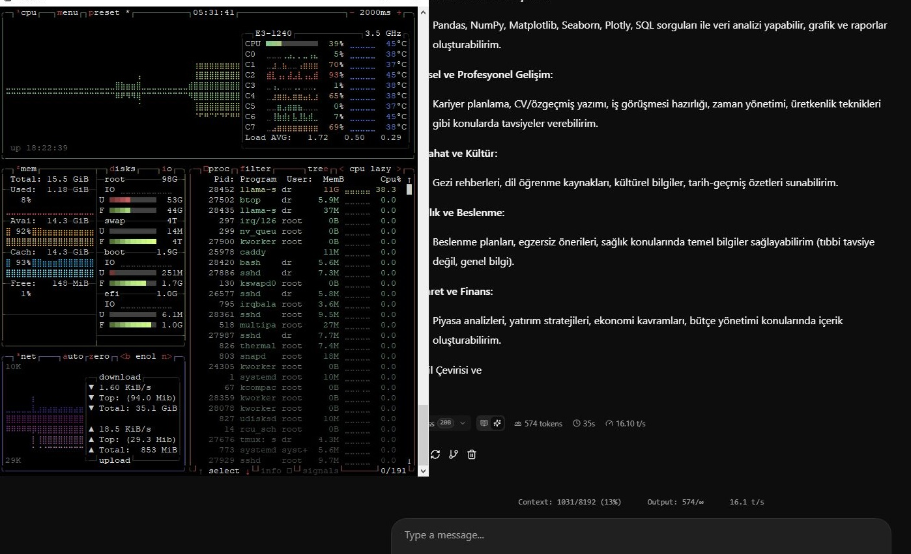

# GPT-OSS 20B on NVIDIA Quadro K5200 — \~16 Tokens/sec

**Running GPT-OSS 20B MXFP4 on a 2014-era NVIDIA Quadro K5200 (8 GB VRAM) using a custom CUDA compute capability 3.5 build of llama.cpp.**

This project documents a real-world local LLM experiment demonstrating that an older Kepler-generation workstation GPU can run a modern 20B-parameter Mixture-of-Experts model at usable inference speeds.

## Hardware Configuration

| Component        | Specification                               |
| ---------------- | ------------------------------------------- |
| Workstation      | HP Z240                                     |
| CPU              | Intel Xeon E3-1240 v5 (4 cores / 8 threads) |
| GPU              | NVIDIA Quadro K5200                         |
| GPU Architecture | Kepler, Compute Capability 3.5              |
| VRAM             | 8 GB GDDR5                                  |
| System Memory    | 16 GB DDR4                                  |
| Operating System | Ubuntu Server                               |
| Inference Engine | llama.cpp, custom CUDA build                |
| llama.cpp Build  | b1-b367989                                  |

## Model Configuration

**Model:** GPT-OSS-20B-Uncensored-HauhauCS-Aggressive (MXFP4 GGUF)

Model source: [https://huggingface.co/HauhauCS/GPT-OSS-20B-Uncensored-HauhauCS-Aggressive](https://huggingface.co/HauhauCS/GPT-OSS-20B-Uncensored-HauhauCS-Aggressive)

| Parameter         | Value                             |
| ----------------- | --------------------------------- |
| Context size      | 16,384 tokens                     |
| GPU offloading    | 25/25 layers                      |
| Auto-fit          | Enabled                           |
| Parallel requests | 1                                 |
| Reasoning         | Disabled via server configuration |
| Model management  | llama.cpp Router Mode             |
| Web tools         | Exa MCP through llama.cpp Web UI  |

### Model-specific INI preset

```
version = 1

[gpt-oss-20b]
model = /home/dr/models/gpt-oss-20b/GPT-OSS-20B-Uncensored-HauhauCS-MXFP4-Aggressive.gguf
ctx-size = 16384
parallel = 1
fit = on
fit-ctx = 16384
reasoning = off
```

### Server launch command

```
~/llamacpp-kepler/build/bin/llama-server \
  --models-dir /home/dr/models \
  --models-preset /home/dr/gpt-oss-presets.ini \
  --models-max 1 \
  --fit on \
  --reasoning off \
  --webui-mcp-proxy \
  --host 0.0.0.0 \
  --port 8081
```

## Real-World Performance

Two observed generation speeds:

| Test                          | Generation Speed |
| ----------------------------- | ---------------- |
| Initial text inference        | 16.1 tokens/sec  |
| Web-assisted weather research | 15.47 tokens/sec |

**Observed generation throughput: approximately 15–16 tokens/sec.**

These are real-world measurements taken from the llama.cpp Web UI, not standardized benchmark averages. Prompt processing and web tool execution introduce additional latency.

## Memory and GPU Offloading

The following values were captured from the model-loading logs while running with a 16,384-token context window.

```
load_tensors: offloading output layer to GPU
load_tensors: offloading 23 repeating layers to GPU
load_tensors: offloaded 25/25 layers to GPU

load_tensors: CPU_Mapped model buffer size = 10949.33 MiB
load_tensors: CUDA0 model buffer size = 6095.35 MiB

llama_kv_cache: CUDA0 KV buffer size = 384.00 MiB
llama_kv_cache: CUDA0 KV buffer size = 18.00 MiB

sched_reserve: CUDA0 compute buffer size = 398.38 MiB
```

## Benchmark Screenshot



**Observed result: 16.10 tokens/sec**

This screenshot captures GPT-OSS 20B MXFP4 running through the llama.cpp Web UI on an HP Z240 workstation equipped with an NVIDIA Quadro K5200 8GB.

- Context window: 8,192 tokens
- Generated output: 574 tokens
- Generation speed: 16.10 tokens/sec
- Generation time: approximately 35 seconds

A subsequent test with a 16,384-token context window achieved **15.47 tokens/sec**.

These results represent observed generation throughput rather than standardized benchmark averages.

### Interpretation

All 25 offloadable layers were assigned to the GPU.

The reported CUDA model buffer, KV buffers, and compute buffer total approximately 6.73 GiB. This does not include every possible driver or runtime allocation.

The CPU-mapped model buffer was approximately 10.69 GiB.

The CPU-mapped allocation should not be interpreted as additional exclusive physical RAM consumption. Memory-mapped model data may overlap with file-backed pages and operating-system caches.

## Example Test: Web-Assisted Research

The model was tested using Exa MCP to research a seven-day weather forecast for Melbourne, Australia.

Observed result:

- Generated a structured seven-day forecast table.
- Included temperature, rainfall probability, rainfall amounts, and wind.
- Produced a source URL.
- Completed a response with a reported generation speed of 15.47 tokens/sec.

The response contained some interpretation and translation errors, so the successful tool-assisted output should not be treated as proof of factual accuracy.

## Important Notes

- The Quadro K5200 is a Kepler-generation GPU with compute capability 3.5.
- Modern llama.cpp CUDA builds generally require additional consideration for this older GPU generation.
- This setup uses a custom llama.cpp build with K5200 support.
- The results are specific to this hardware, model quantization, compilation environment, and workload.
- Successful GPU layer offloading does not mean all model data resides exclusively in VRAM.
- Results have not yet been replicated through a controlled multi-run benchmark.

## Conclusion

This experiment demonstrates that GPT-OSS 20B MXFP4 can run on an HP Z240 workstation with an NVIDIA Quadro K5200 8 GB, using a compatible custom llama.cpp CUDA build.

With a 16K context window, observed generation throughput reached approximately **15–16 tokens per second**.

The result illustrates the continued potential of older workstation hardware for local AI inference, particularly with Mixture-of-Experts models and appropriate memory management.

[GPT-OSS 20B running at 16.10 tokens/sec on NVIDIA Quadro K5200](benchmark-screenshot.JPG)

---

**Keywords:** GPT-OSS 20B, Quadro K5200, NVIDIA Kepler, CUDA 3.5, llama.cpp, local LLM, MXFP4, HP Z240, GPU offloading, AI benchmarking.
